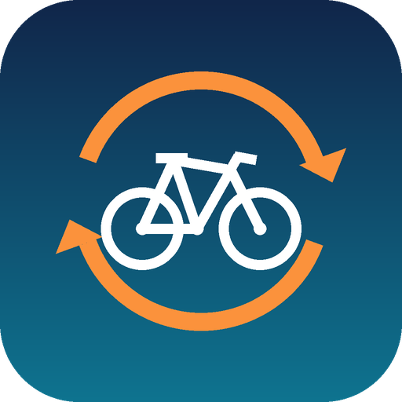

# mywhoosh-garmin-bridge



MyWhoosh only uploads to Strava. This container gets those rides into Garmin Connect automatically, and keeps Strava at one copy of each ride.

1. MyWhoosh uploads a ride to Strava.
2. Strava notifies [StreetSweep](https://github.com/chadbeaudin/street-sweep), whose worker forwards the activity to this bridge over the LAN.
3. The bridge downloads the ride's original FIT file from Strava (it never logs into MyWhoosh, so it can't clash with the single session you're riding on), re-attributes it to a Garmin Edge 840 (so Garmin counts it for training metrics) and uploads it to Garmin Connect.
4. Garmin auto-syncs the ride back to Strava. The bridge recognises that copy (same start time, Garmin Edge device, uploaded after the MyWhoosh copy, no photos) and deletes it through the Strava website, since the Strava API can't delete activities.

It only ever deletes a Strava activity it caused; outdoor Garmin rides are never touched. Details are in [docs/SPEC.md](docs/SPEC.md).

## Setup (Unraid)

1. Add the template: **Docker → Add Container → Template URL** `https://raw.githubusercontent.com/chadbeaudin/mywhoosh-garmin-bridge/main/templates/mywhoosh-garmin-bridge.xml`, or copy the XML to `/boot/config/plugins/dockerMan/templates-user/`.
2. Fill in Garmin credentials, your Strava athlete ID, a random `BRIDGE_SECRET`, and optionally Telegram for alerts.
3. If your Garmin account uses MFA, complete the first login once:
   ```sh
   docker exec -it mywhoosh-garmin-bridge python -m bridge.garmin_login
   ```
4. **Strava remember token** (for downloading rides and deleting the duplicate): log in at strava.com in a browser, open DevTools → Application → Cookies → `https://www.strava.com`, and copy the value of `strava_remember_token`. It expires after about 30 days; the bridge warns over Telegram 5 days before.
5. In StreetSweep's worker container set `BRIDGE_URL=http://<unraid-ip>:8095/events`, `BRIDGE_SECRET` (same value) and `BRIDGE_ATHLETE_ID`.
6. Leave `DRY_RUN=true` for the first ride. The Telegram alert and log show which Strava activity it would delete; when that's right, set `DRY_RUN=false`.

### Automatic updates

Every tested commit on `main` publishes `bigtimber/mywhoosh-garmin-bridge:latest`. Unraid has no built-in auto-update, so install **Auto Update Applications** from Community Applications, then under **Settings → Auto Update Applications → Docker Auto Update Settings** enable it for this container.

## Development

```sh
python3.12 -m venv .venv
.venv/bin/pip install -r requirements-dev.txt
.venv/bin/pytest
```

## Credits

FIT re-attribution is adapted from [marcelorodrigo/mywhoosh-to-garmin](https://github.com/marcelorodrigo/mywhoosh-to-garmin). The Strava web download and delete follow [pR0Ps/stravaweblib](https://github.com/pR0Ps/stravaweblib). Licensed GPL-3.0.
