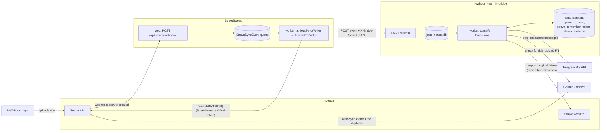
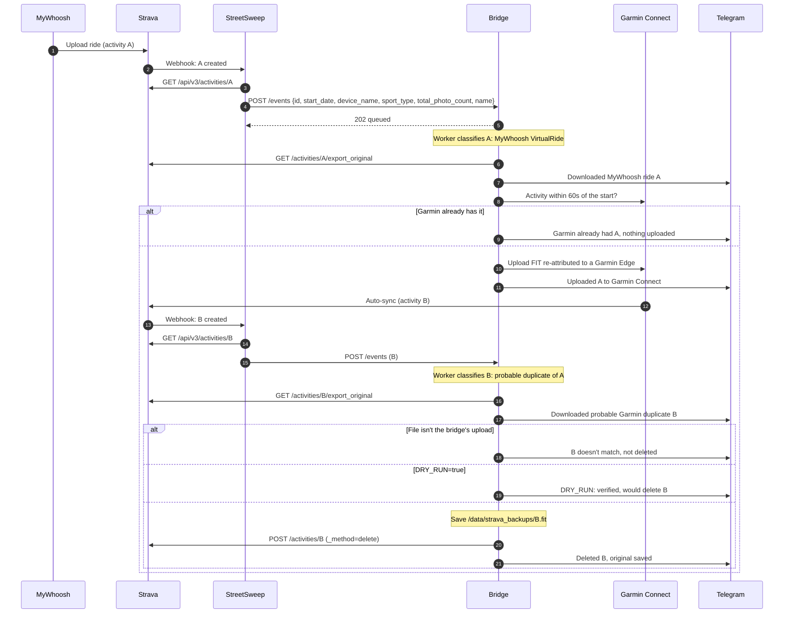

# mywhoosh-garmin-bridge — Spec

## Goal

When a MyWhoosh ride (recorded on iPad) finishes, get it into Garmin Connect automatically, and keep Strava at exactly one copy of the ride.

Today: MyWhoosh → Strava (keep as is). Garmin → Strava auto-sync is on (keep as is).

The bridge never holds a Strava API token. Strava rotates refresh tokens, so a second holder of StreetSweep's token would break StreetSweep's.

## Flow

1. MyWhoosh uploads the ride to Strava.
2. Strava sends a push-subscription `create` event to StreetSweep's existing webhook (one subscription per Strava app, so the bridge rides on StreetSweep's).
3. StreetSweep's worker, which runs on Nastromo, fetches the activity with the token it already holds and forwards it over the LAN to the bridge's `POST /events` (see StreetSweep changes).
4. The bridge classifies the activity (see Classification).
5. **MyWhoosh-origin ride:**
   1. Download the ride's original FIT file from Strava through the web session (`/activities/{id}/export_original`). Retry every 5 min, up to 6 attempts, if it fails. The bridge never logs into MyWhoosh: MyWhoosh allows one session per account, so a login would clash with the rider's iPad.
   2. Rewrite the device to Garmin Edge 840 (manufacturer 1, product 4024) so Garmin counts it for training metrics.
   3. Skip if Garmin already has an activity starting within 60s; otherwise upload to Garmin Connect.
   4. Record the ride in the state DB as `uploaded` (`uploading` while the upload is in flight).
6. Garmin pushes the uploaded ride to Strava, which reaches the bridge the same way.
7. **Garmin-origin duplicate:** download its original file from Strava and verify it (below), save it to `/data/strava_backups/<activity id>.fit` so an accidental delete can be restored by re-uploading it, then delete it from Strava via the Strava web session. Nothing is deleted if the download, verification or backup fails. If the delete fails, send a Telegram notification with the activity link so it can be deleted by hand.

## Diagrams

### Components

StreetSweep forwards only the owner's (`BRIDGE_ATHLETE_ID`) newly created activities, and never fails its own sync if the bridge is down. The bridge holds no Strava API token; it reaches Strava only through the website.

### One ride

## Classification

A Strava activity is treated as the **duplicate to delete** only if all of these hold:

- Its start time is within 60s of a ride in the state DB marked `uploading`/`uploaded` (i.e. one this bridge uploaded to Garmin in the last 48h).
- Its `device_name` is a Garmin Edge (not MyWhoosh).
- Its Strava activity ID is higher than the MyWhoosh copy's (Strava IDs increase with upload order).
- It has no photos (`total_photo_count == 0`; the MyWhoosh copy carries the MyWhoosh ride image).
- It is not the Strava activity ID of the MyWhoosh copy.

The event's fields come from the webhook, so before deleting, the bridge also checks Strava's original file for the activity: it must be the FIT the bridge uploaded (Garmin manufacturer, the bridge's Edge product ID, start within 60s of the ride). A mismatch marks the ride `duplicate_needs_review` and notifies instead of deleting.

If the MyWhoosh copy's Strava ID is unknown (rides recorded by earlier versions), the bridge only notifies with the link instead of deleting.

Anything else is ignored. The bridge never deletes a ride it did not cause, so real outdoor Garmin rides are never touched.

A Strava activity is **MyWhoosh-origin** if its `device_name` identifies MyWhoosh and it is a virtual ride. The rule is `sport_type == "VirtualRide"` and `device_name` containing "mywhoosh"; every classification is logged at INFO so the first real ride confirms it. A ride that doesn't match isn't synced.

## Components

- **Python 3.12**, FastAPI + uvicorn, one container.
- **Events endpoint:** `POST /events` accepts `{id, athlete_id, aspect_type, start_date, device_name, sport_type, total_photo_count}` from StreetSweep, authenticated with the `X-Bridge-Secret` header, enqueues it and returns 202. Only `create` events are acted on. Listens on the LAN only; no public hostname.
- **Worker:** single background thread draining a SQLite-backed job queue, so events survive restarts and are processed one at a time.
- **State:** SQLite at `/data/state.db` — rides (ride ID, which is the MyWhoosh copy's Strava ID, or the MyWhoosh ID for older rides; start time, Strava IDs of both copies, status), jobs, and notification rate limits.
- **Strava web client:** downloads the original upload and deletes by posting `_method=delete` with the CSRF token, as `stravaweblib` does. Password login is behind reCAPTCHA, so it uses the browser's `strava_remember_token` cookie (a JWT, ~30-day expiry). Any refreshed token Strava sets is saved to `/data`, and the token check warns over Telegram 5 days before expiry.
- **FIT rewrite:** adapted from `marcelorodrigo/mywhoosh-to-garmin` (GPL-3.0, credited).
- **Garmin client:** `garminconnect` 0.3, tokens persisted in `/data/garmin_tokens`. Tokens are seeded once, with MFA, through `docker exec -it <container> python -m bridge.garmin_login`.
- **Token check:** every 6h, check the Strava token. Rides whose event never reached the bridge are not caught.
- **Notifications:** Telegram message for each step, naming the Strava activity by ID, name (when the event carries one) and link: MyWhoosh ride downloaded, uploaded to Garmin or Garmin already had it, Garmin duplicate downloaded, then deleted with its backup path, would-be-deleted in dry run, or not deleted because its file didn't match, and on any failure that needs a human: Strava delete failed (with the activity link), Strava token missing or expiring, or a job gave up after 6 attempts (Garmin login, Strava download). Repeating alerts are limited to one a day.
- **Health:** `GET /healthz` for the Unraid/Docker healthcheck.
- **Startup log:** the version, settings and ride and job counts, then a live connection check of Strava, Garmin and Telegram. The checks run on the worker thread, so a slow service never delays startup, and a failed check is logged without stopping the bridge.

## Configuration (env)

| Var | Purpose |
|---|---|
| `GARMIN_USERNAME`, `GARMIN_PASSWORD` | Garmin login (token seeding/refresh) |
| `BRIDGE_SECRET` | Shared secret StreetSweep sends on `/events` |
| `STRAVA_ATHLETE_ID` | Only events for this athlete are processed |
| `STRAVA_REMEMBER_TOKEN` | Web-session download and delete |
| `TELEGRAM_BOT_TOKEN`, `TELEGRAM_CHAT_ID` | Failure notifications |
| `DRY_RUN` | Log the delete instead of doing it (default `true` until the first ride is verified) |
| `TOKEN_CHECK_INTERVAL_HOURS` (default 6) | Strava token check period |
| `TZ`, `LOG_LEVEL`, `PORT` (default 8080), `DATA_DIR` (default `/data`) | Standard |

## Packaging and delivery

- **Repo:** `chadbeaudin/mywhoosh-garmin-bridge`, public, GPL-3.0, default branch `main`.
- **Docker image:** `bigtimber/mywhoosh-garmin-bridge`, `linux/amd64`, non-root, `/data` volume, healthcheck on `/healthz`.
- **CI (GitHub Actions):** on push to `main`, run pytest, compute the semantic version (`feat` → minor), tag the repo, then build and push `:latest` and `:vX.Y.Z` to Docker Hub. PRs run tests and build the image without pushing. Same pattern as `velotron_converter`.
- **Unraid:** template at `templates/mywhoosh-garmin-bridge.xml` with `TemplateURL`, `Icon` (a PNG in the repo), port, `/data` path, and all env vars (secrets masked). Matches the `street-sweep.xml` format.
- **Auto-update:** Unraid has no per-container auto-update setting. Use the Community Applications **Auto Update Applications** plugin with only this container selected, on an hourly check. Unraid's Docker update notification announces new images. Only tested images reach `:latest`.

## StreetSweep changes (separate PR in `chadbeaudin/street-sweep`)

- When the worker processes a `create` activity event for `BRIDGE_ATHLETE_ID`, fetch the detailed activity and POST the fields above to `BRIDGE_URL` with `BRIDGE_SECRET`.
- Fire-and-forget with a short timeout: a bridge outage never fails or retries StreetSweep's own job. Rides during an outage are not synced.
- Disabled when `BRIDGE_URL` is unset, so other deployments are unaffected.
- Unit test for the forward decision and payload; integration test that a failing bridge doesn't affect the sync job.

## Testing

- Unit tests: classification rules (each rule failing on its own keeps the activity), start-time matching, events auth and validation, queue persistence, FIT rewrite, delete failure → notification.
- Integration tests: full event → Strava download → Garmin → duplicate-delete flow with HTTP mocked at the boundary (`responses`), using synthetic fixtures (no personal ride data in the public repo).
- First live ride runs with `DRY_RUN=true`; delete is enabled after the log shows the right activity chosen.

## Out of scope

Outdoor rides, rides from other apps, multi-user support, any web UI.

## Risks

- Strava web download and delete, and Garmin SSO, are all unofficial and can break without notice. Each failure path notifies over Telegram rather than failing silently.
- Strava may change its web flows; a failed download alerts after its retries, and a failed delete sends a notification with the link to delete by hand.
